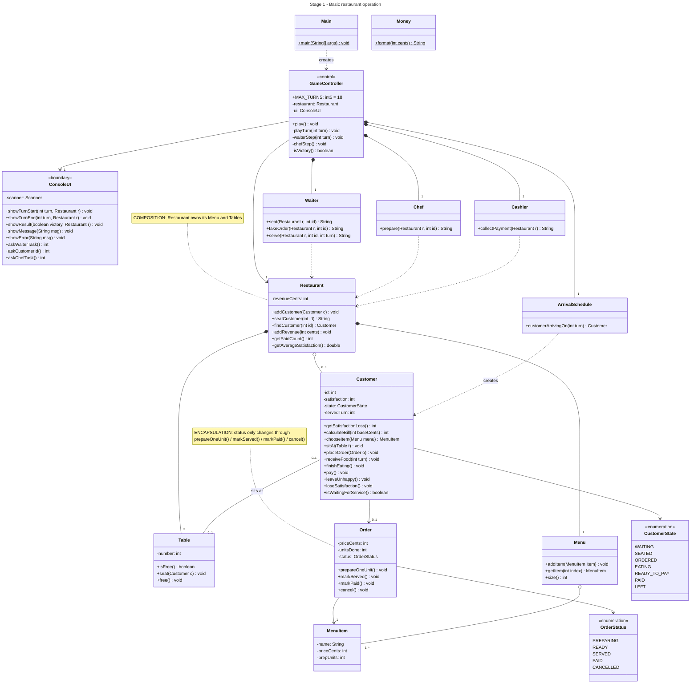
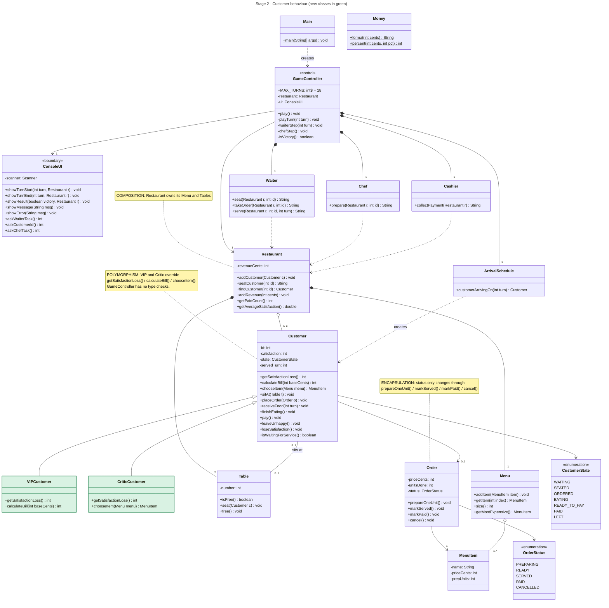
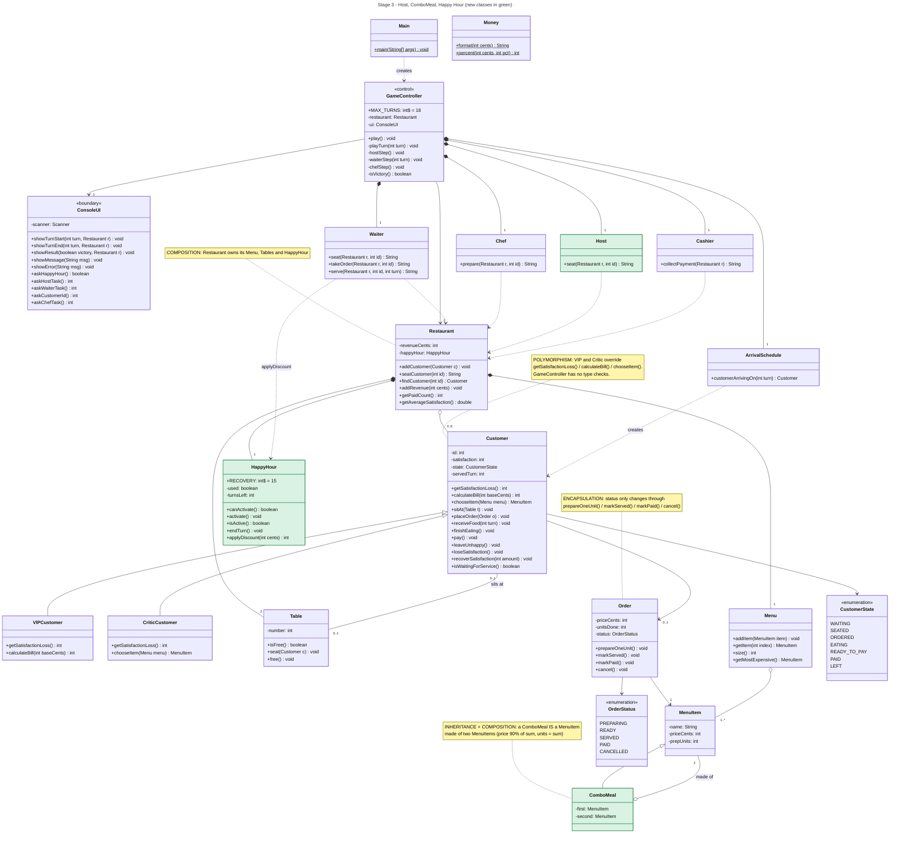
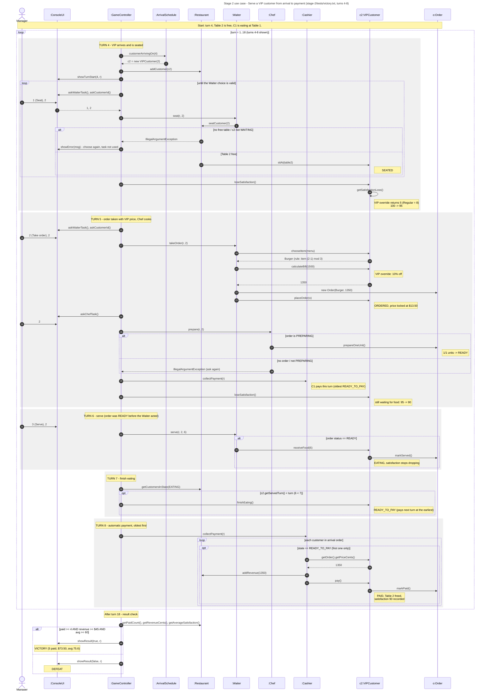

# UML Diagrams

GitHub shows these diagrams directly. To get PNG pictures for the PDF report, open
`view-diagrams.html` in a browser and click **Download PNG** under each diagram
(or paste a `.mmd` file into https://mermaid.live).

## Stage 1 class diagram

Regular customers, menu, Waiter / Chef / Cashier, tables, full turn sequence, victory and defeat.

## Stage 2 class diagram

Adds `VIPCustomer` and `CriticCustomer` (green). Small additions: `Menu.getMostExpensive()` (Critic's choice) and `Money.percent()` (VIP discount). `GameController`, `Waiter`, `Chef`, `Cashier` and `ConsoleUI` are unchanged.

## Stage 3 class diagram

Adds `Host`, `ComboMeal` and `HappyHour` (green). Changed: `GameController` (Happy Hour + Host steps), `ConsoleUI` (new prompts), `Waiter.takeOrder()` (Happy Hour price), `Restaurant` (owns `HappyHour`), `Customer.recoverSatisfaction()`.

## Stage 2 sequence diagram

**Use case (Stage 2): serve a VIP customer from arrival to payment.**

- **Run:** `stage-2/tests/victory.txt`, turns 4-8 (customer C2, a VIP).
- **Starting conditions:** turn 4, Table 2 is free, C1 is eating at Table 1.
- **Outcome:** C2 pays $13.50 (Burger $15.00 - 10% VIP discount) with satisfaction 90 on turn 8.
  At the end of turn 18 the result check gives VICTORY (5 paid, $73.50, avg 75.6).

**How the interactions implement it**

1. **Arrival** - `GameController` asks `ArrivalSchedule` who arrives; on turn 4 it creates a `VIPCustomer`.
2. **Manager choice** - the manager tells the Waiter to seat C2 straight away. The loop shows that an invalid
   choice (no free table, wrong customer) is rejected and asked again without using up the task.
   Seating at once matters: every turn C2 waits costs satisfaction.
3. **Stage 2 behaviour (polymorphism)** - `GameController` just calls `loseSatisfaction()`; the VIP object
   answers `getSatisfactionLoss() = 5` (a Regular would lose 8). When the order is taken the `Waiter` calls
   `calculateBill(1500)` and the VIP returns 1350. No `instanceof` checks anywhere.
4. **Kitchen** - the Chef does one unit; the 1-unit Burger becomes READY. The Waiter already acted this turn,
   so it is served on turn 6 (guard: `status == READY`).
5. **Eating and payment** - on turn 7 the guard `servedTurn < turn` moves C2 to READY_TO_PAY; on turn 8 the
   Cashier picks the oldest READY_TO_PAY customer, adds the locked price to revenue and frees the table.
6. **Result** - after turn 18 `GameController` checks the three targets and shows VICTORY or DEFEAT.

